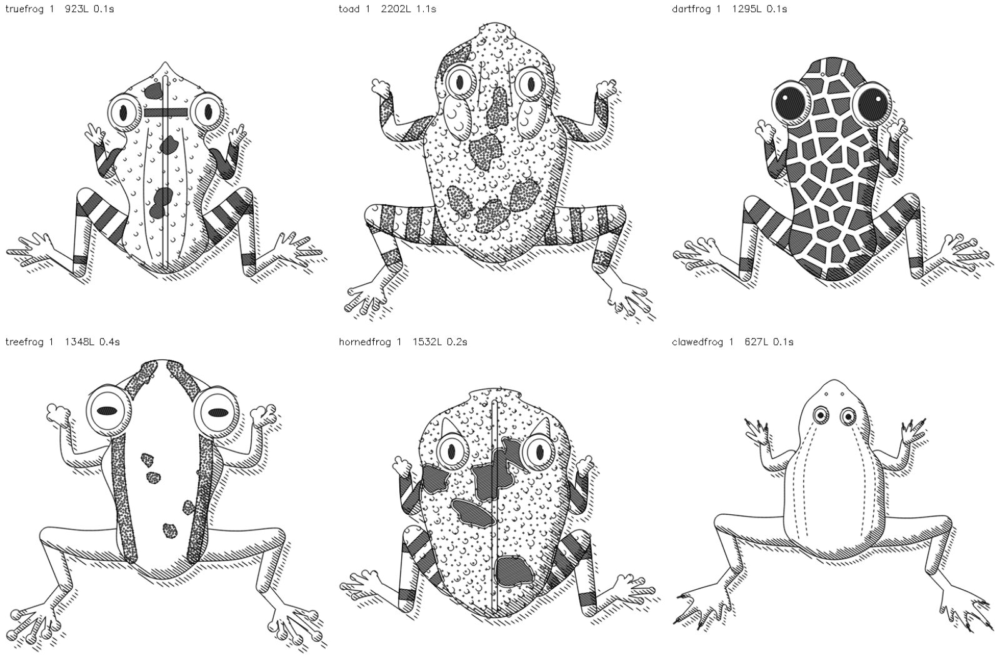

# Image → G-code

Turns photographs into drawings for a pen plotter, with a web UI and a
command line. Built around an AX4 / GRBL machine, but the G-code is plain and
portable.

Goals:

1. **Keep the pen down.** Strokes are welded, bridged and ordered so a plot
   lifts as rarely as possible.
2. **Keep the dynamic range.** Tone is reproduced as ink coverage, continuously,
   rather than posterised into a few hatch layers.
3. **Capture form and detail.** A learned line-drawing model draws the lines an
   illustrator would keep; shading follows the subject's shape.


## Quick start

```
pip install -r requirements.txt          # torch is optional, see the file
./run.sh                                  # web UI on http://localhost:8080
python3 image_to_gcode.py photo.jpg -o photo.gcode
python3 image_to_gcode.py photo.jpg --minutes 12   # fit a 12-minute plot
python3 image_to_gcode.py --list-engines
```

## Engines

| Engine         | Look                                                 | Pen lifts         |
|----------------|------------------------------------------------------|-------------------|
| `illustration` | Learned line drawing over shadow-only cross-hatching | fewest            |
| `crosshatch`   | Layered engraving; directions stack as tone darkens  | many medium       |
| `flowlines`    | Strokes follow the image's own structure             | many long strokes |
| `adaptive`     | Cross-hatch where smooth, flow lines where textured  | many, mixed       |
| `waves`        | One serpentine sweep; tone from how far it detours   | near-continuous   |
| `hilbert`      | A single space-filling curve, adaptive depth         | one curve         |
| `tsp`          | Stipple density joined into one continuous tour      | one tour          |
| `contours`     | Tonal isolines, long closed loops                    | few long loops    |
| `outline`      | Traced edges only, no shading                        | few strokes       |
| `lineart`      | Centreline trace of an existing drawing or scan      | few strokes       |

**`illustration`** (learned lines over cross-hatched shadows) is the default.
`crosshatch` and `flowlines` carry more of the photo's full tonal range at 2-5×
the plot time; `flowlines` suits heavily textured subjects best. `adaptive`
helps when one photo mixes texture with smooth shading. `hilbert` and `tsp`
are for when pen lifts matter more than detail.

How each part works is in [docs/algorithms.md](docs/algorithms.md); machine
notes in [docs/hardware.md](docs/hardware.md); current results on the test
photos in [docs/evaluation](docs/evaluation/README.md).

## Drawing from scratch

Besides converting photos, it can generate frogs from scratch, seen from
above, structured like LingDong's [fishdraw](https://github.com/LingDong-/fishdraw):
every part has several anatomical variants chosen independently, so the
combinations multiply. Each frog first draws a real family - true frog, toad,
tree frog, poison dart frog, horned frog or clawed frog - and the family sets
the range every other choice is drawn from, so results stay plausible: toads
get warts, parotoid glands and short webbing, tree frogs get toe discs, dart
frogs get bold stripes, network or blotch patterns, clawed frogs get tiny eyes,
huge webbed feet and lateral-line stitches.

Like in fishdraw, the name is the seed. With no name a pseudo-Latin binomial
is invented and the drawing is seeded from it; type that name back (any
spelling or capitalisation) and you get the identical frog. The genus ending
encodes the family (-rana, -bufo, -hyla, -bates, -phrys, -pipa), so a name
reproduces its family too. The name is lettered under the drawing in a
single-stroke Hershey font, so the plotter draws it cleanly.

    python3 image_to_gcode.py --draw frog                       # invent one
    python3 image_to_gcode.py --draw frog --name "Calopus zycuops"
    python3 image_to_gcode.py --draw toad --name "Bufo hannesii"



Parts are closed polygons drawn front to back, each clipped by what is in
front of it, and shaded fishdraw's way: hatch the part of each shape not
covered by a copy shifted toward the light. Generation takes 0.1-1 s.

## Repository layout

```
app.py              web UI (Flask)
image_to_gcode.py   command line
run.sh              starts the web UI with the right interpreter
plotter/            the library: tone, engines, paths, G-code
  engines/          one module per drawing style
  procedural/       frogs generated from scratch
tools/
  evaluate.py       render the photo set through engines, side by side
  gcode_rotate.py   turn an existing portrait G-code file to landscape
samples/
  photos/           CC0 test photographs (see CREDITS.md)
  wiresphere.svg    vector test drawing
docs/
  algorithms.md     how each part works, and why
  hardware.md       the AX4, pen width, plot speed, portrait output
  evaluation/       current results on the photo set
```

## Using it as a library

The `plotter/` package is importable on its own:

```python
import plotter
cfg = plotter.Config()
cfg.render.engine = "hilbert"
result = plotter.convert(plotter.load_image("photo.jpg"), cfg)
open("photo.gcode", "w").write(result.gcode())
```

## Optional dependencies

`torch` enables depth estimation and the learned line model (Informative
Drawings, MIT licence); both run on Apple Silicon's Metal backend. Depth uses
Depth Anything V2 Small (Apache-2.0) when `transformers` is installed and
MiDaS otherwise. Weights download on first use. Without torch, engines fall back to
classical methods. `rembg` powers background removal.
