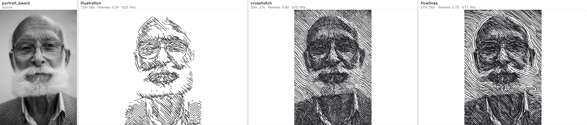
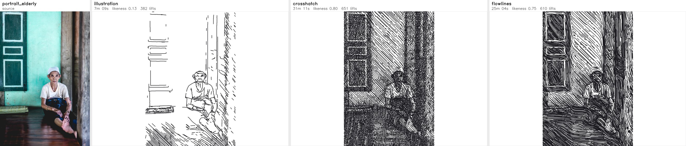
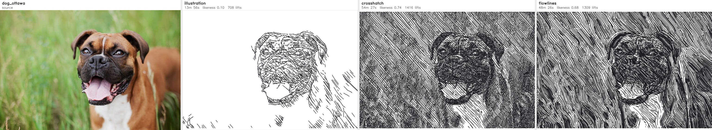
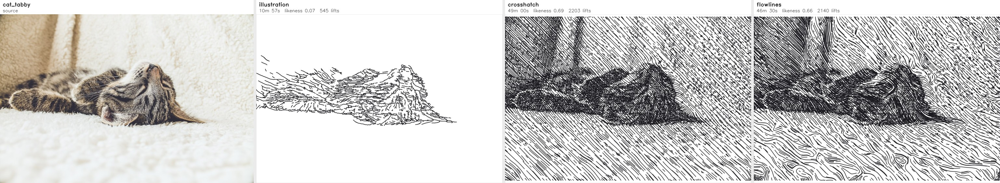
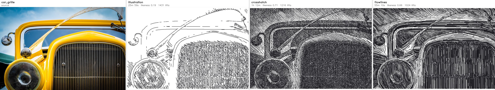
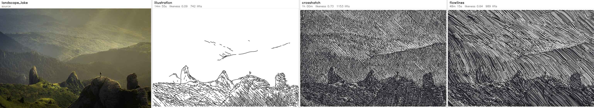

# Evaluation

The six CC0 photographs in `samples/photos/` run through the three main
engines at default settings. Each sheet shows the source, then
`illustration`, `crosshatch` and `flowlines`, labelled with estimated plot
time, likeness and pen lifts.

**Likeness** is SSIM between the finished plot and the photo's tone target,
both seen from arm's length: every G-code path is drawn at the pen's real
width, then both images are blurred by 1 mm (`plotter/quality.py`). Read it
next to plot time to see what a change buys per minute. Compare it within an
engine, not across engines: `illustration` deliberately leaves light and mid
tones to the paper, so it scores far below the dense tone engines even where
it looks better.

Regenerate with:

    python3 tools/evaluate.py -e illustration crosshatch flowlines -o eval_out

Judge changes on the whole set. Two earlier defaults in this project were
wrong because they were tuned on a single picture.

## portrait beard

## portrait elderly

## dog ottawa

## cat tabby

## car grille

## landscape lake

## Numbers

| photo | engine | plot time | likeness | tone error | lifts | drawn m | compute s |
|---|---|---|---|---|---|---|---|
| car_grille | illustration | 25m 59s | 0.194 | 0.423 | 1431 | 19.2 | 5.5 |
| car_grille | crosshatch | 1h 12m | 0.706 | 0.079 | 1216 | 93.7 | 5.5 |
| car_grille | flowlines | 55m 10s | 0.664 | 0.088 | 1024 | 93.9 | 4.2 |
| cat_tabby | illustration | 10m 57s | 0.075 | 0.227 | 545 | 5.6 | 2.0 |
| cat_tabby | crosshatch | 49m 00s | 0.689 | 0.052 | 2203 | 46.5 | 3.2 |
| cat_tabby | flowlines | 46m 30s | 0.660 | 0.056 | 2140 | 46.5 | 3.1 |
| dog_ottawa | illustration | 13m 56s | 0.101 | 0.408 | 708 | 8.5 | 2.2 |
| dog_ottawa | crosshatch | 54m 27s | 0.740 | 0.074 | 1416 | 70.5 | 4.3 |
| dog_ottawa | flowlines | 48m 26s | 0.679 | 0.078 | 1309 | 71.0 | 3.9 |
| landscape_lake | illustration | 14m 55s | 0.087 | 0.491 | 742 | 9.7 | 2.2 |
| landscape_lake | crosshatch | 1h 00m | 0.734 | 0.086 | 1153 | 82.9 | 4.6 |
| landscape_lake | flowlines | 48m 15s | 0.645 | 0.102 | 989 | 78.0 | 3.7 |
| portrait_beard | illustration | 13m 06s | 0.238 | 0.344 | 625 | 8.1 | 2.1 |
| portrait_beard | crosshatch | 30m 27s | 0.804 | 0.070 | 615 | 37.1 | 2.6 |
| portrait_beard | flowlines | 27m 56s | 0.754 | 0.073 | 673 | 36.5 | 2.5 |
| portrait_elderly | illustration | 7m 09s | 0.126 | 0.458 | 382 | 5.0 | 1.5 |
| portrait_elderly | crosshatch | 31m 11s | 0.798 | 0.093 | 651 | 39.5 | 2.8 |
| portrait_elderly | flowlines | 25m 04s | 0.751 | 0.095 | 610 | 37.8 | 2.3 |
